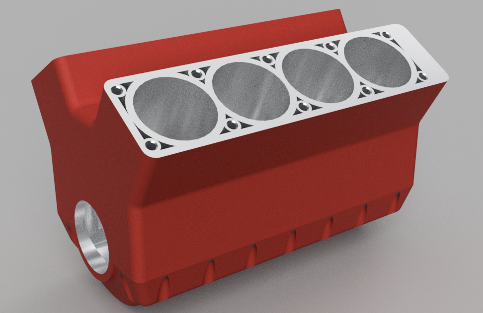

3D Printable V8 Engine-Block, Crankshaft, Pistons & Oil Pan :

What is this ?

This is fully 3D printable V8 engine that i designed from scratch in fusion 360. Its the bottom end of v8, so it has the engine block, a crankshaft, 8 piston with their own connective rods and the oil pan. When you turn the crank shaft by hand every piston goes up and down in its cylinder just like a real enigne. No heads or Valves yet, thats the next version, but its already really satisfying to spin. 

Note : Every part is its own file (STEP included) so you can print, edit or remix what ever you want in CAD.

Why i made ? 

Honestly, I'm just really into mechanical things. I'm planning to do my bachelor in mechanical engineering, so i wanted a project that actually teaches me something. 

Designing it taught me a lot about :

1) How a V8 crankshaft is laid out 
2) How pistons and rods turn up-down motion into rotation 

Part List (Needed to print ):
## Engine Parts

| Part | Qty | Notes |
|:---|:---:|:---|
| Engine Block | 1 | Main body that holds the crankshaft and 8 cylinders |
| Crankshaft | 1 | Should be printed strong |
| Crankshaft Bearing | 2 | Sits between the crankshaft and engine block |
| Piston Head | 8 | One per cylinder |
| Piston Rod | 8 | Connects the piston to the crankshaft |
| Piston Rod Cap | 8 | Clamps the rod around the crank journal |
| Piston Rod Pin | 8 | Holds the piston head to the rod |
| Oil Pan | 1 | Closes the bottom of the engine block |

Assembly Guide : 

Step 1 : Clean everything. Take off supports. Pay attention to cylinder bores, piston heads, crank journals and the holes in the rods, even tiny bumps make parts stick.

Step 2: Test  fit. Before using grease, dry fit one pin in a rod and one rod on the crank journal. If its too tight, sand lightly. Don't force anything PLA wll crack. 

Step 3 : Build  the 8 piston assemblies. For each one: put the piston rod inside the piston head, line up  the holes and push the rod pin through. 

Step 4 : Prepare the crankshaft. slide the crank shaft bearings on to the crank  in their spots. Add tiny bit of grease. 

Step 5 : Install the crankshaft in the block. Lay the crank (with bearing) into the block and spin it by hand. It should rotate easy with no tight spots. 

Step 6 : Install the piston. Slide each piston into the cylinder,  then guide the rod end down on to its crank journal. 

Step 7 : Attach the rod caps. Put the piston rod cap on each rod around the crank journal and tighten with the screw. Don't over tighten, snug is enough, the rod should still swing freely.

Step 8 : Check Every things. spin the crank slowly a full rotation. All piston should move smoothly with no clicking or sticking.

Step 9 : Close the oil pan. Put the oil pan on the bottom of the block and fix it with the screws.

Step 10 : Final test. Spin the crank by hand a few times and if its run smoothly then congrats :)

Future improvement :

This is only version 1, i have big plans : 

1) cylinder head 
2) valves and valves springs
3) camshaft and timing system 
4) intake and exhaust manifolds
5) Fkywheel and a little motor 

Full working V8 where the valves open and closes with the pistons. 

The final goal is a complete miniature V8 that look and works like the real things.

Thank for checking out my  project! I'm still a student and still learning. 

